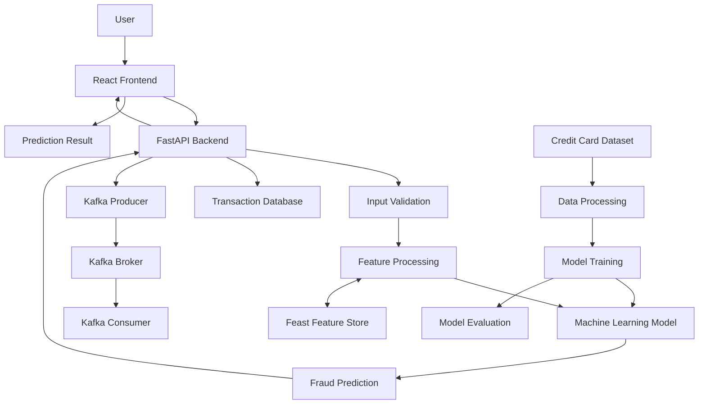

# 💳 Financial Fraud Detection Platform

An end-to-end Machine Learning platform designed to detect potentially fraudulent credit card transactions using data processing, machine learning, and real-time transaction-processing technologies.

The platform provides a web interface for submitting transaction details and viewing fraud predictions through a FastAPI backend.

## 🌐 Live Demo

| Component            | Link                                                     |
| -------------------- | -------------------------------------------------------- |
| Frontend Application | https://financial-fraud-detection-nu.vercel.app          |
| Backend API          | https://financial-fraud-detection-tf41.onrender.com      |
| API Documentation    | https://financial-fraud-detection-tf41.onrender.com/docs |
| GitHub Repository    | https://github.com/Mymudh/financial-fraud-detection      |

## 📌 Project Overview

Credit card fraud is a major challenge in digital financial transactions. Detecting fraudulent activities accurately and quickly can help reduce financial losses and improve transaction security.

This project implements a machine learning-based fraud detection platform that analyzes transaction features and predicts whether a transaction is potentially legitimate or fraudulent.

The application combines a React frontend, FastAPI backend, and machine learning model. It also includes components for event processing, feature management, model evaluation, and automated testing.

## ✨ Key Features

* **Fraud Detection:** Predicts potentially fraudulent credit card transactions.
* **Machine Learning:** Uses a trained ML model for transaction classification.
* **Interactive Dashboard:** Provides a frontend for submitting transactions and viewing results.
* **REST API:** Exposes prediction functionality through FastAPI.
* **API Documentation:** Provides interactive API documentation using Swagger UI.
* **Feature Engineering:** Prepares transaction features for model prediction.
* **Kafka Integration:** Supports event-based transaction processing.
* **Feature Store:** Uses Feast for feature management.
* **Model Evaluation:** Includes model evaluation and performance metrics.
* **Automated Testing:** Uses GitHub Actions for continuous integration.

## 🏗️ System Architecture

The following diagram illustrates the main components and their interactions.



### Architecture Components

| Component              | Description                                                  |
| ---------------------- | ------------------------------------------------------------ |
| React Frontend         | Provides the user interface and displays prediction results. |
| FastAPI Backend        | Handles API requests and prediction operations.              |
| Input Validation       | Checks incoming transaction data.                            |
| Feature Processing     | Prepares transaction features for the model.                 |
| Machine Learning Model | Classifies transactions for fraud detection.                 |
| Feast Feature Store    | Supports feature management.                                 |
| Kafka                  | Supports event-based transaction processing.                 |
| Transaction Database   | Supports transaction data storage.                           |
| Model Evaluation       | Evaluates the trained model.                                 |

## 🛠️ Technology Stack

### Programming Languages

* Python
* JavaScript

### Machine Learning

* Scikit-learn
* Pandas
* NumPy
* Machine Learning Classification
* Feature Engineering
* Model Evaluation

### Backend

* FastAPI
* Uvicorn
* REST APIs

### Frontend

* React.js
* Vite
* JavaScript
* CSS

### Data Engineering and MLOps

* Apache Kafka
* Feast Feature Store
* MLflow

### Database and Storage

* SQLite
* CSV

### DevOps and Deployment

* Docker
* Docker Compose
* Git
* GitHub
* GitHub Actions
* Vercel
* Render

## 📁 Project Directory Structure

```text
financial-fraud-detection/
│
├── .github/
│   └── workflows/
│       └── ci.yml
│
├── artifacts/
│   ├── fraud_model.joblib
│   ├── evaluation_metrics.json
│   └── features/
│
├── backend/
│   ├── main.py
│   ├── transactions_db.py
│   ├── test_health.py
│   ├── test_gnn_prediction.py
│   ├── test_kafka_consumer.py
│   ├── test_kafka_prediction.py
│   └── test_kafka_producer.py
│
├── datasets/
│   └── sample_creditcard.csv
│
├── feature_store/
│   └── data/
│
├── frontend/
│   ├── public/
│   ├── src/
│   │   ├── assets/
│   │   ├── App.jsx
│   │   ├── App.css
│   │   ├── index.css
│   │   └── main.jsx
│   ├── package.json
│   └── vite.config.js
│
├── k8s/
│
├── ml/
│   ├── train_model.py
│   ├── train_gnn.py
│   ├── evaluate_model.py
│   ├── feature_engineering.py
│   ├── explore_data.py
│   ├── drift_monitor.py
│   └── auto_retrain.py
│
├── tests/
│
├── create_sample_dataset.py
├── .dockerignore
├── .gitignore
├── Dockerfile
├── docker-compose.yml
├── feature_store.yaml
├── requirements.txt
├── runtime.txt
└── README.md
```

*Note: This is a representative project structure. Some local files, generated artifacts, and configuration files may not be included in the GitHub repository.*

## 📂 Dataset

This project uses the **Credit Card Fraud Detection** dataset.

**Original Dataset:**
[Credit Card Fraud Detection – Kaggle](https://www.kaggle.com/datasets/mlg-ulb/creditcardfraud)

**Alternative Dataset Mirror:**
[Credit Card Fraud Detection – Zenodo](https://zenodo.org/records/7395559)

### Dataset Information

| Attribute               | Details |
| ----------------------- | ------- |
| Total Transactions      | 284,807 |
| Normal Transactions     | 284,315 |
| Fraudulent Transactions | 492     |
| Total Columns           | 31      |
| Target Column           | `Class` |
| Fraud Class             | 1       |
| Normal Class            | 0       |

### Dataset Included in This Repository

The repository includes:

```text
datasets/
└── sample_creditcard.csv
```

The sample dataset contains:

* 2,000 normal transactions
* 492 fraudulent transactions
* 2,492 total transactions

The original dataset is approximately 143.84 MB locally and is excluded from GitHub because it exceeds GitHub's standard 100 MB file limit.

### Generate the Sample Dataset Locally

If you have downloaded the original `creditcard.csv`, place it inside the `datasets/` folder.

Run:

```bash
python create_sample_dataset.py
```

This generates:

```text
datasets/sample_creditcard.csv
```

## ⚙️ Installation and Setup

### 1. Clone the Repository

```bash
git clone https://github.com/Mymudh/financial-fraud-detection.git
```

### 2. Navigate to the Project

```bash
cd financial-fraud-detection
```

### 3. Create a Virtual Environment

```bash
python -m venv venv
```

Activate it on Windows:

```powershell
venv\Scripts\activate
```

### 4. Install Python Dependencies

```bash
pip install -r requirements.txt
```

### 5. Start the Backend

```bash
uvicorn backend.main:app --reload
```

Backend:

```text
http://127.0.0.1:8000
```

API Documentation:

```text
http://127.0.0.1:8000/docs
```

### 6. Start the Frontend

Open another terminal:

```bash
cd frontend
```

Install dependencies:

```bash
npm install
```

Start the development server:

```bash
npm run dev
```

Open the local frontend URL displayed in your terminal.

## 🔌 API Documentation

The backend provides REST API endpoints through FastAPI.

**Live API Documentation:**

https://financial-fraud-detection-tf41.onrender.com/docs

You can use the interactive Swagger interface to inspect and test the available API endpoints.

## 🧪 Testing and Continuous Integration

The project includes automated testing and a GitHub Actions workflow.

The CI workflow helps validate project changes and run automated tests.

**GitHub Actions:**

https://github.com/Mymudh/financial-fraud-detection/actions

## 🚀 Deployment

The application is deployed using separate frontend and backend services.

| Service     | Platform       |
| ----------- | -------------- |
| Frontend    | Vercel         |
| Backend     | Render         |
| Source Code | GitHub         |
| CI/CD       | GitHub Actions |

### Deployment Links

* Frontend: https://financial-fraud-detection-nu.vercel.app
* Backend: https://financial-fraud-detection-tf41.onrender.com
* API Documentation: https://financial-fraud-detection-tf41.onrender.com/docs

## 📊 Model Evaluation

The project includes model training and evaluation scripts.

```text
ml/
├── train_model.py
├── train_gnn.py
├── evaluate_model.py
└── feature_engineering.py
```

Evaluation metrics are stored in:

```text
artifacts/evaluation_metrics.json
```

Important evaluation metrics for fraud detection include:

* Accuracy
* Precision
* Recall
* F1-Score
* Confusion Matrix
* ROC-AUC Score

Because fraud datasets are highly imbalanced, precision, recall, and F1-score should be considered alongside accuracy.

## 🔐 Security and Data Handling

* Validate incoming transaction data.
* Avoid exposing API keys and credentials.
* Keep sensitive configuration in environment variables.
* Exclude large datasets and generated artifacts from GitHub.
* Use appropriate input validation before model prediction.

## 🔮 Future Improvements

* Advanced fraud detection models.
* Improved real-time transaction processing.
* Enhanced fraud monitoring dashboard.
* Explainable AI for prediction interpretation.
* Model drift detection and automated retraining.
* Advanced feature engineering.
* Improved model performance and evaluation.
* Scalable deployment architecture.

## 👨‍💻 Author

**Shaik Maimood**

AI/ML Engineer | Machine Learning | Deep Learning | Generative AI

### Connect With Me

* GitHub: https://github.com/Mymudh
* Project Repository: https://github.com/Mymudh/financial-fraud-detection

---

⭐ If you find this project useful, consider giving the repository a star!
